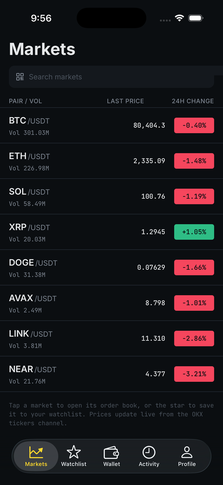
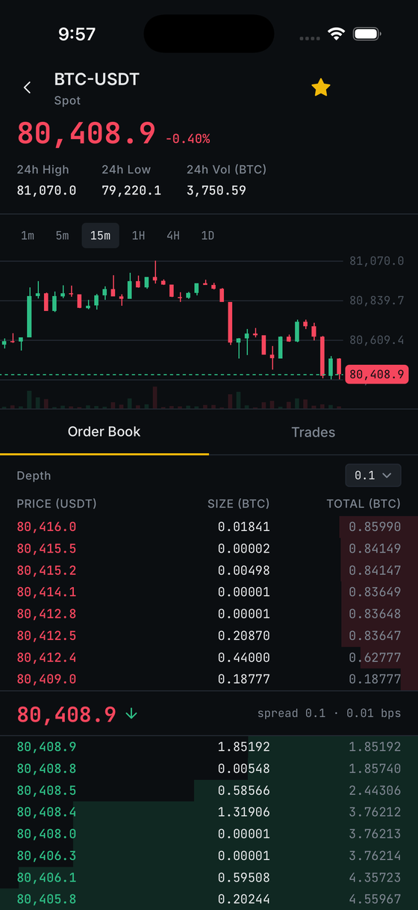
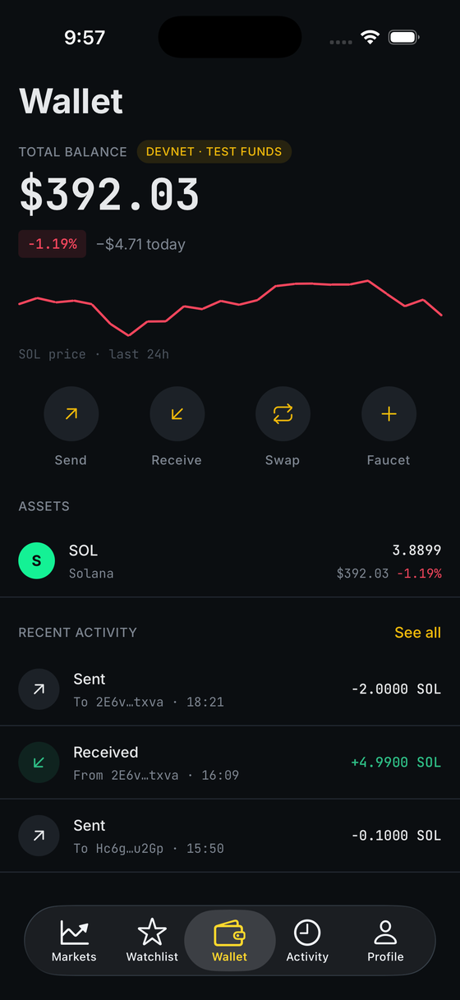
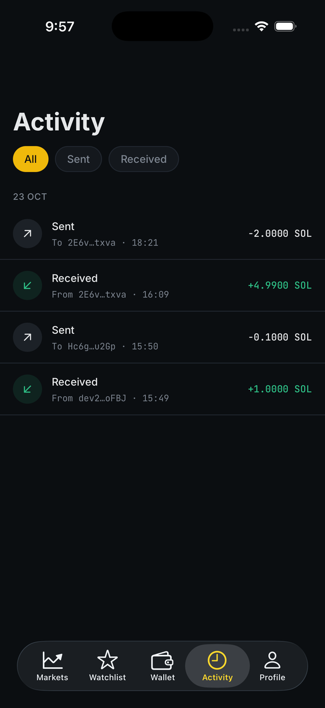
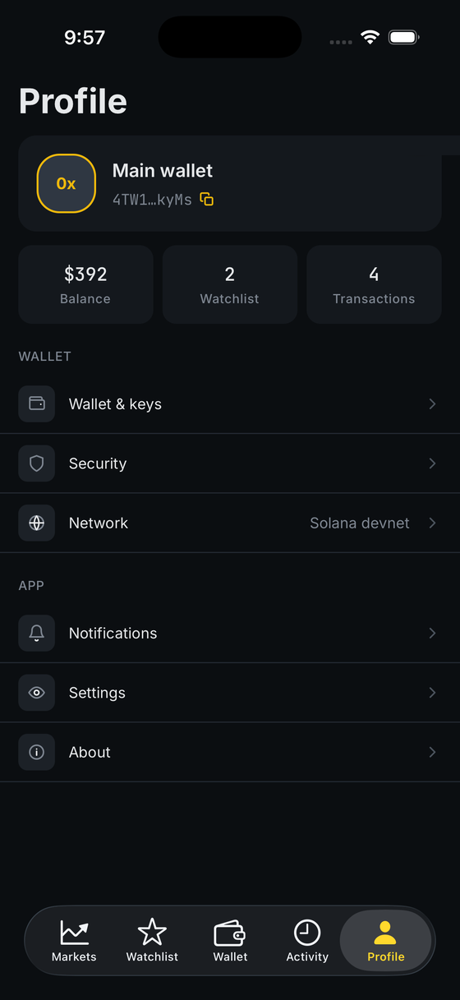
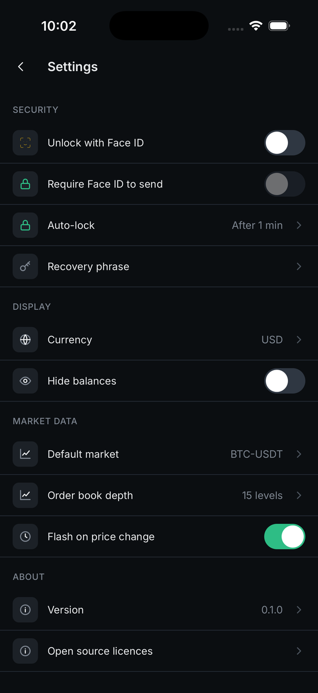
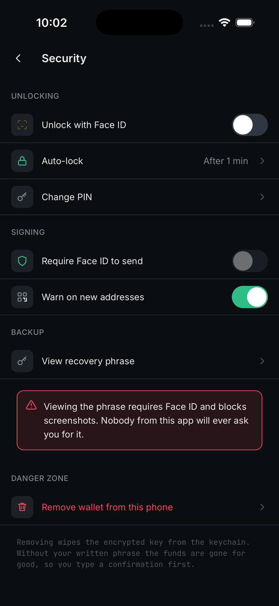
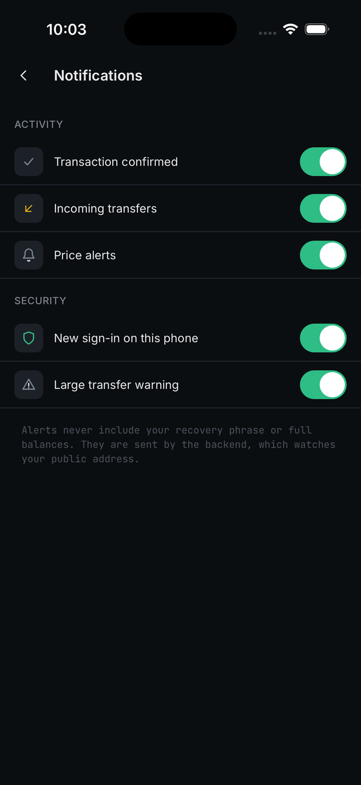
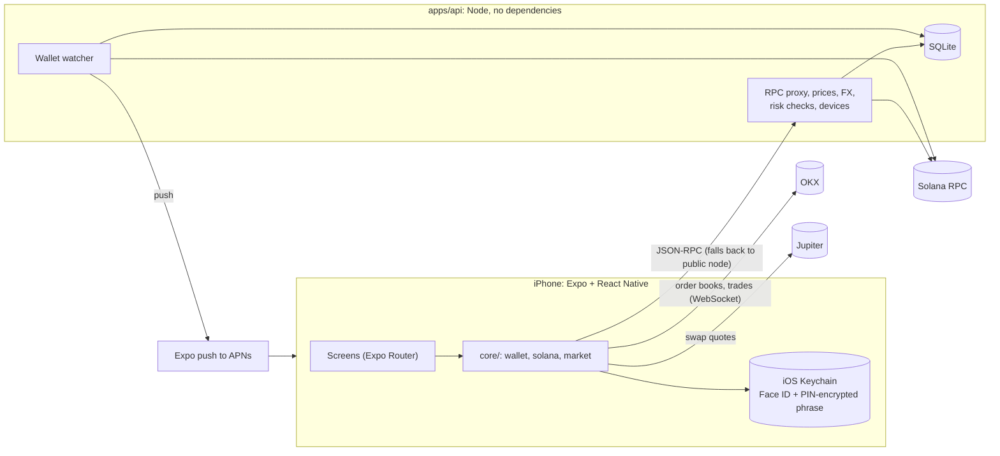

# Orderbook

[](https://github.com/dipo0x/orderbook/actions/workflows/ci.yml)

**A self-custody Solana wallet with a live exchange order book, built end to end: iOS app, backend and tests.**

Watch real-time order books and candles from OKX, hold SOL, send and receive, swap through Jupiter, and keep your keys
on your own phone, behind Face ID. A small backend does the jobs a phone is bad at (an RPC proxy, push alerts, shared
price caches, recipient checks) without ever holding a key.

<p>
  
  
  
  
</p>
<p>
  
  
  
  
</p>

Designed in Figma (dark theme, iOS 26 Liquid Glass tab bar) and implemented screen by screen.

## What it does

**Markets**
- Live order book with grouping, depth bars and a spread bar, plus trades and candlestick charts with pan and pinch.
- One shared OKX WebSocket for every screen. The local book is rebuilt from a snapshot plus incremental updates; a missed
  update or a crossed book triggers an automatic resync, and the connection recovers with backoff and reconnects as soon
  as the app returns to the foreground.
- Search across every OKX spot market, a watchlist, and a "flash on price change" option.

**Wallet**
- Create or import a 12-word wallet (BIP-39, SLIP-0010 at `m/44'/501'/0'/0'`, the same address Phantom derives).
- SOL balance, a 24-hour price sparkline, SPL token balances, receive with a QR code, and send with a pre-flight
  simulation, an exact network fee, and confirmation tracking.
- Swap SOL, USDC and USDT through Jupiter, with the quote, price impact and minimum received shown before you sign.
- Devnet, testnet and mainnet, switchable at any time. Devnet comes with a faucet.
- Activity feed and transaction detail with a Solscan link; display currency in USD, NGN, EUR or GBP.

**Security**
- Face ID and a 6-digit PIN, auto-lock (including when you open the app switcher), a privacy cover in the app switcher,
  screenshot blocking on secret screens, and a clipboard that clears itself.
- Recipient safety: an address you have never paid before asks for extra confirmation, lookalike addresses that imitate
  one you have paid (address poisoning) are blocked, and the backend flags known-bad and never-used addresses.
- View the recovery phrase, export the private key, change the PIN, or remove the wallet (with a typed confirmation).

## Architecture



**Keys never leave the phone.** The app builds, signs and approves every transaction. The backend can proxy a signed
transaction to the network, but it has no way to create one.

The app works with no backend running: Solana requests, prices and currency rates fall back to the public services when
the backend is missing or down, so the backend is an upgrade and not a dependency.

### Repository layout

```
apps/
  mobile/            Expo SDK 58 app (React Native 0.88, Expo Router, Uniwind/Tailwind v4)
    src/app/           routes only
    src/features/      one folder per flow: markets, wallet, send, swap, activity, profile, ...
    src/core/          pure logic with no UI: wallet/ (keys, PIN crypto), solana/, market/
    src/components/ui/ design-system pieces
    test/              22 offline tests + opt-in live checks
  api/               Backend: RPC proxy, notifications, prices, risk checks (42 tests, see apps/api/README.md)
packages/
  shared/            API contract types shared by the app and the backend
docs/screenshots/    Images for this README
```

## Security model

| Concern | How it is handled |
|---|---|
| Where keys live | Only on the phone. The recovery phrase is stored in the iOS keychain twice: once behind Face ID, and once encrypted with AES-256-GCM under a key derived from the PIN (PBKDF2-SHA256). Either alone opens the wallet. |
| When keys exist in memory | The phrase is decrypted only to sign (or to show it after you authenticate). The signing key is wiped straight afterwards. |
| Signing the right wallet | Before signing, the app derives the address from the stored phrase and checks it equals the wallet on screen. If one copy has drifted, it falls back to the other and repairs it. A mismatch aborts the send. |
| Third-party transactions (swaps) | The transaction comes from Jupiter's server, so the signer first checks that this wallet is the only signer and the fee payer, and the app simulates it before asking for Face ID. |
| PIN guessing | Attempts are counted before each check, survive app restarts, and lock out for 1 minute doubling to 1 hour. Nothing is ever deleted. A 6-digit PIN cannot resist offline guessing on its own, so the real protection is the keychain plus these limits. |
| Exact money maths | Amounts are `bigint` base units. Typed amounts are parsed without floating point, so `0.1 + 0.2` is exactly `0.3`. |
| Backend trust | The proxy allowlists methods, refuses batches, caps body size and rate-limits per IP. Logs never contain bodies, keys or full addresses. |

This is a learning project and has **not been independently audited**. Use devnet, or very small amounts on mainnet.

## Try it

**You need:** Node 24+, and for iOS: Xcode with a simulator (an iPhone with a development build is best for Face ID).

```bash
git clone https://github.com/dipo0x/orderbook.git
cd orderbook
npm install
```

**1. Start the backend (optional, but recommended)**

```bash
npm run api            # http://localhost:3000
```

**2. Start the app**

```bash
cp apps/mobile/.env.example apps/mobile/.env      # points the app at the backend
npm run mobile                                     # then press i for the iOS simulator
```

- On the **simulator**, Expo Go works.
- On a **physical iPhone**, Face ID and the keychain need a development build:
  `cd apps/mobile && npx expo run:ios --device`. Set `EXPO_PUBLIC_API_URL` to your computer's LAN address
  (for example `http://192.168.1.20:3000`) so the phone can reach the backend.
- After adding styles or routes, restart with `npm run start:clear`.

**3. Get test money**

Create a wallet in the app (stay on **Devnet**), then paste your address into [faucet.solana.com](https://faucet.solana.com).
Send some SOL to another address and watch it confirm. The Activity tab and the Solscan link show the transaction.

**Swap** only works on mainnet, because the exchanges it routes through don't exist on devnet. Switch in
Profile, then Network, and use a tiny amount.

**Push notifications** are opt-in because Apple only allows the capability on a paid Developer Program account (a free
"Personal Team" can't build with it). You need that account, a real device, the backend reachable from it, and an Expo
project ID. Run `npx eas init` once in `apps/mobile`, then build with the capability on:

```bash
cd apps/mobile
ENABLE_PUSH=1 npx expo prebuild --platform ios --clean
npx expo run:ios --device
```

Then turn alerts on in Profile, then Notifications. Without this the app builds on any account, and the Notifications
screen explains why alerts are unavailable.

## Backend

A dependency-free Node service (built-in `http`, `node:sqlite` and `node:test`; TypeScript runs directly, no build step).

| Endpoint | What it does |
|---|---|
| `POST /rpc/:cluster` | Allowlisted, rate-limited proxy to the Solana node, so a provider API key stays on the server |
| `GET /prices`, `GET /fx` | OKX tickers and currency rates, cached and shared across phones, served stale if the source is down |
| `POST /risk/check` | Flags invalid, flagged, self and never-used recipients |
| `POST` / `DELETE /devices` | Sign a phone up for, or remove it from, alerts |

A watcher turns on-chain activity into notifications: received money, confirmed or failed sends, large transfers, a new
phone added to your wallet, and sharp SOL price moves. The first pass over a wallet only records where its history
ends, so old transactions never notify, and a transaction the node can't read yet is retried instead of skipped.

Full reference and operating notes: [`apps/api/README.md`](apps/api/README.md).

## Testing

```bash
npm run check                              # typecheck + lint + all tests (what CI runs)
npm test                                   # 22 app tests + 42 API tests
npm run test:live -w @orderbook/mobile     # read-only checks against devnet, OKX and Jupiter
```

What the tests pin down:

- **Keys:** the standard "abandon ... about" phrase gives the address Phantom gives; the published BIP-39 vectors; the same
  phrase always gives the same address; the exported key imports into `@solana/web3.js`.
- **Transactions:** the hand-built transfer is **byte-identical to `@solana/web3.js`**, including the largest possible
  amount, and signatures verify. A swap-style transaction signs correctly and is refused when someone else is the fee payer.
- **Crypto:** a wrong PIN, a tampered ciphertext and weak PINs are rejected; every wrap uses a fresh salt and nonce.
- **Order book:** sequence gaps, heartbeats, crossed books, and grouping that never crosses the spread.
- **Backend:** rate limiting, the RPC allowlist, caching with stale-if-error, risk checks, the watcher (including first-pass
  and retry behaviour) and the HTTP layer, all against fakes so nothing touches the network.
- **Live (opt-in):** real devnet reads, an OKX order book with no sequence gaps over ten seconds, and a Jupiter quote.

## Engineering notes

- **The transfer transaction is built by hand** (`core/solana/transaction.ts`) to understand the wire format, then checked
  byte for byte against the official library in tests, rather than trusting either blindly.
- **One shared WebSocket** with reference-counted subscriptions, a heartbeat, exponential backoff, and resync states
  surfaced in the UI (connecting, live, resyncing, reconnecting).
- **React Compiler rules are followed**: no refs read during render and no effects that only set state.
- **Design tokens** from Figma live in one `@theme` block, and fonts load through a Metro resolver exception so Uniwind and
  `expo-asset` cooperate.
- **A dependency-free backend** keeps the surface small enough to read in one sitting (about 1,000 lines).
- **A type-safe contract** between app and server through `packages/shared`.

## Limitations and roadmap

- iOS only for now; Android has not been tested.
- Token names, logos and prices are only shown for SOL, USDC and USDT. Other SPL tokens appear by mint address.
- Swaps use a standard Jupiter quote; the first mainnet swap is still to be done by hand.
- Notification delivery to a device needs a paid Apple Developer account and an Expo project ID; the server side is tested
  against a stand-in push endpoint and a real devnet transaction.
- The watcher polls. Provider webhooks or a Geyser stream would replace it at scale.
- Not yet: Ethereum and Bitcoin, hardware wallets, WalletConnect, and fiat on-ramps.

## Credits

Market data from [OKX](https://www.okx.com/docs-v5/en/), swap routing from [Jupiter](https://station.jup.ag/docs),
and cryptography from the audited [`@noble`](https://github.com/paulmillr/noble-curves) and
[`@scure`](https://github.com/paulmillr/scure-bip39) libraries.
